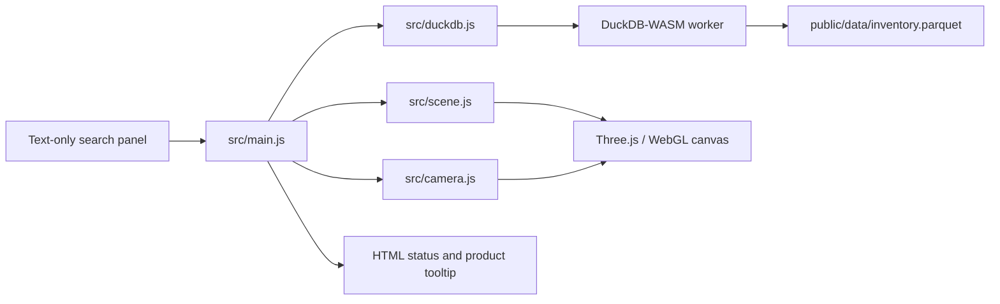

# Warehouse 3D Digital Twin

A static, browser-based warehouse viewer. Search inventory with DuckDB-WASM and locate a product in a Three.js warehouse through a continuous camera flight.

## Stack

- Vanilla JavaScript and Vite
- Three.js with instanced product boxes
- DuckDB-WASM reading Apache Parquet
- GSAP camera animation

## Frontend architecture

For a guided reading path, see [Learning resources](docs/LEARNING_RESOURCES.md).



The browser loads the Parquet file into DuckDB-WASM, queries products by name or SKU, and passes the matching record to the scene and camera modules. Three.js draws the warehouse and its product instances; GSAP moves the camera from its current position.

## Project structure

```text
.
├── AGENTS.md
├── SPEC.md
├── README.md
├── index.html
├── public/
│   └── data/
│       └── inventory.parquet
├── scripts/
│   └── generate_inventory.py
└── src/
    ├── main.js
    ├── duckdb.js
    ├── scene.js
    ├── camera.js
    └── style.css
```

## Run locally

```bash
npm install
npm run dev
```

Open the local URL printed by Vite. Search for an SKU such as `SKU-00001` or a product name such as `Bearing`.

## Regenerate sample inventory

The included `public/data/inventory.parquet` contains 10,000 sample rows. To regenerate it, install the Python `duckdb` package and run:

```bash
python -m pip install duckdb
npm run data:generate
```

The Python script exists only to create reproducible sample inventory for local development. The browser never runs Python. The generator writes Parquet directly. Replace the sample Parquet file with real inventory using the documented schema when you have production data.

## Build

```bash
npm run build
npm run preview
```

Deploy the `dist/` directory to any static host. Keep the generated DuckDB worker and WASM assets alongside the site. If deploying under a subpath, set Vite's `base` accordingly before building.

## Data schema

| Column | Type | Meaning |
| --- | --- | --- |
| `id` | string | Unique product ID |
| `sku` | string | Searchable stock keeping unit |
| `name` | string | Product name |
| `aisle` | string | Aisle A–Z |
| `rack` | integer | Rack 1–15 |
| `level` | integer | Level 1–3 |
| `position` | integer | Slot 0–2 |

Multiple products can share a logical slot. The viewer offsets their boxes slightly within that slot so each record remains visible.
